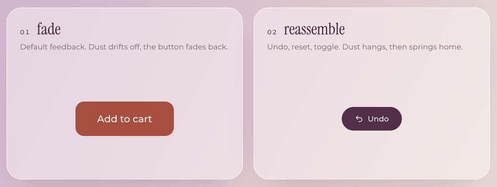
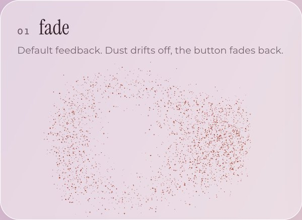
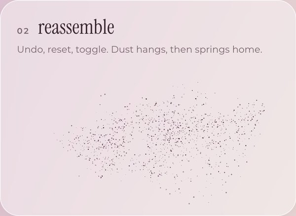
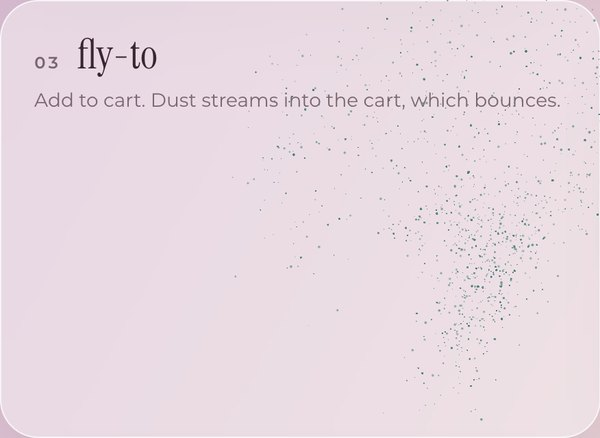
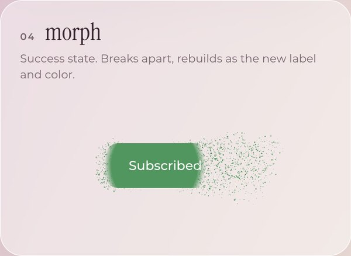
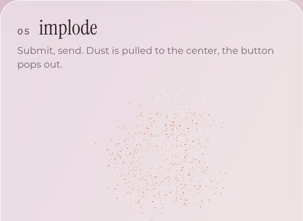
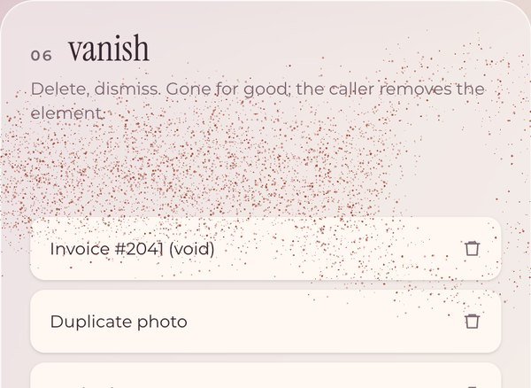

<div align="center">

# Dust

**Buttons that dissolve into particles, then come back six different ways.**

[](https://ga-mo.github.io/button-particle-effect/)
[](./LICENSE)


<a href="https://ga-mo.github.io/button-particle-effect/"></a>

[**Try the playground**](https://ga-mo.github.io/button-particle-effect/) · [Watch as MP4](docs/media/hero.mp4)

</div>

## Why Dust

- **One shared WebGL2 canvas.** Every button on the page draws into a single fixed overlay. Browsers allow only a handful of WebGL contexts per page, so Dust never creates one per button. The canvas stops its animation loop as soon as the last particle is gone.
- **Zero dependencies, 5.0 kB gzip.** The core is about 750 lines of TypeScript and raw WebGL2: 11.4 kB minified, 5.0 kB gzip, measured with `bun build --minify`. It does not import React. A separate optional hook does.
- **No layout shift.** Dust reads the button's position, color and border radius, then hides the real button behind a CSS mask. The button's box never moves, so nothing around it reflows. It stays focusable, and it still works with the keyboard.
- **Feels like dust, not confetti.** Round dots of different sizes, with some out of focus. An impulse, curl noise, drag and light gravity spread them into a soft cloud.

## Six ways back

Pick one with `outro`. It is a single discriminated union, so each kind carries only the fields it needs.

| | `outro` | Use it for | What happens |
| --- | --- | --- | --- |
|  | `{ kind: 'fade' }` | General feedback | The dust drifts away, then the button fades back in. |
|  | `{ kind: 'reassemble' }` | Undo, reset, toggle | The dust hangs in the air, then springs back into the button. |
|  | `{ kind: 'fly-to', target }` | Add to cart | The dust streams into `target`, which bounces. Then the button pops back. |
|  | `{ kind: 'morph', swap }` | Success states | `swap(el)` runs while the button is hidden. The dust returns in the new color. |
|  | `{ kind: 'implode' }` | Submit, send | The dust is pulled to the center, and the button pops out. |
|  | `{ kind: 'vanish' }` | Delete, dismiss | The dust drifts away and the element stays hidden. You remove it. |

## Quick start

Dust is not on npm yet. Copy the source into your project, the way you would add a shadcn/ui component. It has no dependencies, so you copy only the one folder.

```bash
git clone https://github.com/GA-MO/button-particle-effect.git
cp -r button-particle-effect/src/particle src/lib/particle
```

Then use it with any framework, or with none:

```ts
import { attach, burst } from './lib/particle'

// Play once. The promise resolves when the effect has finished.
await burst(button, { outro: { kind: 'implode' } })

// Play on every click or keyboard press. Returns a cleanup function.
const detach = attach(button, { outro: { kind: 'fade' } })
```

## Use with React

`src/particle/react.ts` holds one optional hook, `useDust`. It is the only file that imports React, and it treats React as a peer dependency. Copy it with the rest of the folder, or delete it if you don't use React.

The examples below come from [`examples/react`](examples/react), which the TypeScript check compiles. They import from `@/particle`, so point that alias at your copy of the folder, or change the import path.

### Click handler with `await burst`

`burst` returns a promise, so you can run the real action after the effect ends. Pass the pointer position as `origin` so the dust scatters away from the spot where the user clicked. A keyboard click has `detail === 0`, so the example leaves `origin` out in that case and the dust starts at the center.

<!-- example: examples/react/SendButton.tsx -->
```tsx
import type { MouseEvent } from 'react'
import { burst } from '@/particle'

export function SendButton({ onSend }: { onSend: () => void }) {
  async function handleClick(e: MouseEvent<HTMLButtonElement>) {
    const fromPointer = e.detail > 0
    await burst(e.currentTarget, {
      outro: { kind: 'implode' },
      ...(fromPointer && { origin: { x: e.clientX, y: e.clientY } })
    })
    onSend()
  }

  return (
    <button type='button' onClick={handleClick}>
      Send
    </button>
  )
}
```
<!-- /example -->

### The `useDust` hook

`useDust` returns a ref. Put it on any element, and every click plays the effect with the pointer as the origin. The hook reads options at click time, so you can pass a new object on every render without re-attaching the listener.

<!-- example: examples/react/UndoButton.tsx -->
```tsx
import { useDust } from '@/particle/react'

export function UndoButton({ onUndo }: { onUndo: () => void }) {
  const ref = useDust<HTMLButtonElement>({ outro: { kind: 'reassemble' } })
  return (
    <button ref={ref} type='button' onClick={onUndo}>
      Undo
    </button>
  )
}
```
<!-- /example -->

The hook itself is `attach` inside `useEffect`, with the cleanup returned:

<!-- example: src/particle/react.ts -->
```ts
import { useEffect, useLayoutEffect, useRef } from 'react'
import { attach } from './index'
import type { BurstOptions } from './types'

/**
 * Returns a ref that plays `burst` on every click of the element it is attached to.
 * Options are read at click time, so passing a new object each render does not re-attach.
 */
export function useDust<T extends HTMLElement>(options: BurstOptions | (() => BurstOptions) = {}) {
  const ref = useRef<T>(null)
  const latest = useRef(options)
  useLayoutEffect(() => {
    latest.current = options
  })
  useEffect(() => {
    const el = ref.current
    if (!el) return
    return attach(el, () => {
      const current = latest.current
      return typeof current === 'function' ? current() : current
    })
  }, [])
  return ref
}
```
<!-- /example -->

### Fly to a cart icon

Give the target element a ref, then pass it as `target`. The dust follows the target even if the page scrolls during the effect.

<!-- example: examples/react/AddToCart.tsx -->
```tsx
import { useRef, useState, type MouseEvent } from 'react'
import { burst } from '@/particle'

export function AddToCart() {
  const cartRef = useRef<HTMLSpanElement>(null)
  const [count, setCount] = useState(0)

  async function add(e: MouseEvent<HTMLButtonElement>) {
    const target = cartRef.current
    if (!target) return
    await burst(e.currentTarget, {
      outro: { kind: 'fly-to', target },
      ...(e.detail > 0 && { origin: { x: e.clientX, y: e.clientY } })
    })
    setCount((c) => c + 1)
  }

  return (
    <>
      <span ref={cartRef} aria-label={`Cart, ${count} items`}>
        🛒 {count}
      </span>
      <button type='button' onClick={add}>
        Add to cart
      </button>
    </>
  )
}
```
<!-- /example -->

### Morph into a new state

`swap` runs once the button is fully hidden. Dust then reads the button's new size and color and rebuilds it. The DOM must already show the new state when `swap` returns. A plain `setState` only schedules a render, so wrap it in `flushSync`. Dust also waits one frame after `swap` before it measures, but `flushSync` is what guarantees the commit.

<!-- example: examples/react/SubscribeButton.tsx -->
```tsx
import { useState } from 'react'
import { flushSync } from 'react-dom'
import { burst } from '@/particle'

export function SubscribeButton() {
  const [subscribed, setSubscribed] = useState(false)
  return (
    <button
      type='button'
      style={{ background: subscribed ? '#2f9a5b' : '#4a4fd1' }}
      onClick={(e) =>
        burst(e.currentTarget, {
          outro: {
            kind: 'morph',
            // flushSync commits the new label and color before burst reads them
            swap: () => flushSync(() => setSubscribed((s) => !s))
          }
        })
      }
    >
      {subscribed ? 'Subscribed ✓' : 'Subscribe'}
    </button>
  )
}
```
<!-- /example -->

### Remove an item with `vanish`

`vanish` leaves the element hidden but still in the DOM. Remove it from state after the promise resolves.

<!-- example: examples/react/TodoList.tsx -->
```tsx
import { useState } from 'react'
import { burst } from '@/particle'

export function TodoList({ initial }: { initial: string[] }) {
  const [items, setItems] = useState(initial)

  async function remove(row: HTMLElement, item: string) {
    await burst(row, { outro: { kind: 'vanish' } })
    setItems((list) => list.filter((i) => i !== item))
  }

  return (
    <ul>
      {items.map((item) => (
        <li key={item}>
          {item}
          <button
            type='button'
            onClick={(e) => {
              const row = e.currentTarget.closest('li')
              if (row) void remove(row, item)
            }}
          >
            Delete
          </button>
        </li>
      ))}
    </ul>
  )
}
```
<!-- /example -->

### StrictMode

In development, StrictMode mounts each effect, cleans it up, and mounts it again. `useDust` returns the cleanup from `attach`, so exactly one click listener remains. The playground runs in StrictMode. In Chrome, the fade button has one click listener after the double mount. If you call `burst` again while an effect is still playing on the same element, you get the running promise back, and nothing plays on top of it.

### Next.js and SSR

Dust runs only in the browser. Importing it on the server is safe: the module does not touch `window` or `document` until you call `burst` or `attach`. Calling them needs the DOM, so use them in event handlers and effects, inside a client component:

<!-- example: examples/react/DustButton.tsx -->
```tsx
'use client'

import type { ReactNode } from 'react'
import { useDust } from '@/particle/react'

export function DustButton({ children }: { children: ReactNode }) {
  const ref = useDust<HTMLButtonElement>({ outro: { kind: 'fade' }, direction: 'left' })
  return (
    <button ref={ref} type='button'>
      {children}
    </button>
  )
}
```
<!-- /example -->

## API

### `burst(el, options?) => Promise<{ el, played }>`

Dissolves `el` and plays `options.outro`. The promise resolves when the effect has finished. `played` is `false` when the effect was skipped (see [Accessibility](#accessibility)). If you call it again while an effect is still playing on the same element, you get the running promise back.

### `attach(el, options?) => () => void`

Calls `burst` on every `click`, which includes Enter and Space on a button. For a pointer click, the click position becomes `origin`. `options` can be an object or a function that returns one, read at click time. Returns a function that removes the listener.

### `useDust(options?) => RefObject`

The React hook from `particle/react`. See [Use with React](#use-with-react).

### Options

Every option is optional. These defaults come from `DEFAULTS` in [`src/particle/run.ts`](src/particle/run.ts).

| Option | Default | Description |
| --- | --- | --- |
| `outro` | `{ kind: 'fade' }` | How the element comes back. See [Six ways back](#six-ways-back). |
| `direction` | `'pointer'` | Where the dissolve starts and where the dust flies: `'left'`, `'right'`, `'up'`, `'down'`, or `'pointer'` (away from `origin`). |
| `origin` | element center | `{ x, y }` in client coordinates, for `direction: 'pointer'`. |
| `count` | `3000` | Particles for a 200 × 56 px element. The count scales with the element's area, up to 12,000. |
| `force` | `255` | Initial speed of the dust, in px/s. |
| `curl` | `50` | Strength of the swirling curl-noise field. |
| `drag` | `2.6` | How quickly the dust slows down, per second. |
| `gravity` | `4` | Downward pull in px/s². Use a negative value to make the dust rise. |
| `size` | `2` | Diameter of the largest dot, in CSS px. |
| `blur` | `0.6` | Share of dots drawn soft and out of focus, from 0 to 1. |
| `life` | `2550` | How long the dust floats before it fades or returns, in ms. |
| `dissolve` | `300` | How long the dissolve front takes to cross the element, in ms. |
| `return` | `1500` | How long the dust takes to travel back, in ms. |
| `color` | element color | Any CSS color. Defaults to the background color, then the border color, then the text color. |

## Accessibility

- **Reduced motion.** When `prefers-reduced-motion: reduce` is set, Dust skips the animation. `morph` still runs `swap` so the state changes, and `vanish` still hides the element. The promise resolves with `played: false`.
- **Keyboard.** The real element is never removed or replaced. It stays focusable, Enter and Space still click it, and its accessible name is unchanged.
- **No layout shift.** Only an inline `mask-image` changes during the effect, and it is restored afterwards. `implode` and `fly-to` also play a short `transform: scale` animation. Neither affects layout.
- **Screen readers.** The overlay canvas has `aria-hidden="true"` and `pointer-events: none`.

## Robustness

- **Many at once.** Any number of elements can play at the same time on the one canvas. In the playground, 9 elements at `count: 6000` draw 64,244 dots per frame at 60 fps on a 2× display. This was measured once in Chrome on an Apple Silicon Mac.
- **Scroll and resize.** The dust is positioned relative to its element on every frame, so it moves with the page.
- **Context loss.** If the WebGL context is lost, every running effect jumps to its end state and its promise resolves. Dust rebuilds the renderer for the next effect.
- **No WebGL2.** Dust falls back to the reduced-motion behavior.

## Browser support

Dust needs WebGL2, CSS `mask-image` (Dust also sets `-webkit-mask-image`), the Web Animations API, and `reportError`. That means Chrome and Edge 95+, Firefox 93+, and Safari 15.4+. So far it has been tested only in Chrome.

## Playground

```bash
bun install
bun run dev
```

The playground is in [`src/playground`](src/playground). It uses React 19, Tailwind CSS 4 and Tweakpane. Tune the physics in the panel and press **Reset** to return to the defaults. `bun run build:pages` builds it for GitHub Pages.

## License

[MIT](./LICENSE) © GA-MO
